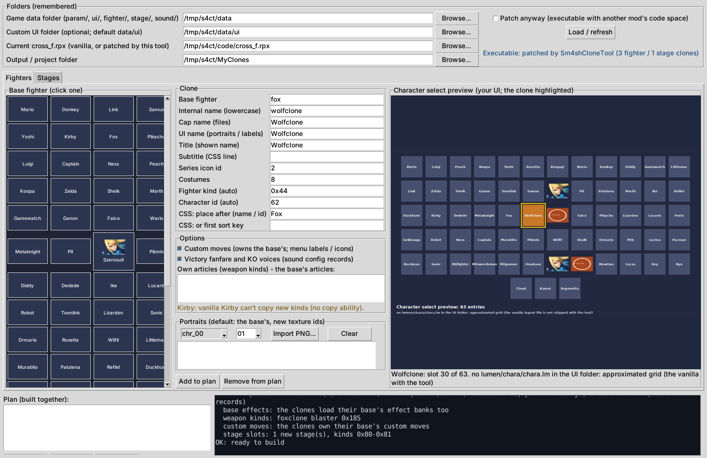

# Sm4shCloneTool

Clone Super Smash Bros. for Wii U fighters and stages into **new slots**, the way BrawlEx's Clone Engine does for
Brawl: pick a base, give the clone a name, choose its portraits and options, see where it lands on the character /
stage select, and build a package to install. A fighter clone is a real new fighter kind (0x41, 0x42, ...) with its
own character id, folder, parameters, names and portraits; a stage clone is a new stage kind with its own stage-select
slot, folder, icons and names. Nothing of the game is replaced.



(Screenshots from a test setup whose UI folder has only a few portraits: the others are drawn as name tiles. With
your full UI every tile is its portrait. More in `screenshots/`: the stage tab, the character / stage select previews.)

## What you need

- **Windows with Python 3.9 or later** (python.org; tick "Add python.exe to PATH"). Tkinter comes with it.
  Linux / macOS work too (`python3 gui.py`; Tkinter from your package manager).
- Your game's **data folder** as you have it installed: `param/`, `ui/`, `fighter/`, `stage/`, `sound/` (dumped from
  the game, or your mod's `content/patch/data` merged over a dump). Vanilla or modded, both work. At least
  `param/ui/ui_character_db.bin` (fighters) or `param/ui/ui_stage_db.bin` (stages), `ui/message/melee.msbt` and the base's
  folder.
- Your **cross_f.rpx** (`code/cross_f.rpx`): the game's latest update (v288) unmodified (SHA-1
  `a4cc56d89726c480637c20bea992a9afe8ee9ad9` as Nintendo ships it; a decompressed copy is recognised by its contents),
  or one this tool patched before. New fighter / stage kinds need the patched executable; without one the tool only makes the data files.
- Optional: a **custom UI folder** (your own portraits, your own character-select layout `lumen/chara/chara.lm`).

## Install

1. Unzip `Sm4shCloneTool_v1_5.zip` anywhere.
2. Double-click **setup.bat** once (installs numpy and Pillow with pip).
3. Double-click **run.bat** (the window) or use **run_cli.bat** (the command line).

## The window

**Folders** (remembered between runs, in `%USERPROFILE%\.sm4shclonetool.json`):

| field | what |
|---|---|
| Game data folder | your data folder (see above) |
| Custom UI folder | optional: the `ui` folder your game shows, if it is not `data/ui` (a UI mod) |
| Current cross_f.rpx | the executable to patch; the label on the right says what it is (vanilla / patched by Sm4shCloneTool, with its clones / not vanilla) |
| Output / project folder | where the package and `sm4shclonetool_project.json` go; use the same folder for every clone of one project |
| Patch anyway | for an executable that is not vanilla because another mod uses the code space after the game's: the clone code then goes after that mod's code (see "The executable") |
| Executable output (1.5) | what the executable patch is written as: **patched cross_f.rpx** (default), **Aroma plugin patch file** (a Wii U with Aroma runs the game's own executable; the plugin patches it in memory), **Cemu graphic pack** (Cemu patches the game's own executable in memory), or all three. See "Without a modified executable". **Rebuild executable outputs** (beside it, 1.5.2) writes the project's clones again for the chosen output without adding a clone; the package keeps the outputs it has (see "Switching the executable output") |

Press **Load / refresh** after changing a folder.

### Fighters tab

Click a **base fighter** in the roster (icons from your UI's `chr_10`, else `chr_00` / `stock_90` / `chr_13`; a `*`
marks your clones, which can be bases too). Each click fills the internal name, Cap name, UI name and title from that
base (`<base>clone`, or `<base>clone2`, `3`, ... when taken; 1.5.2: picking another base replaces the names of the one
picked before). Then fill in:

| field | what | rules |
|---|---|---|
| Internal name | the folder and file name: `fighter/<name>/`, `fighter_param_vl_<name>.bin`, `<name>.mscsb` | lowercase letters / digits, 2-16, not taken |
| Cap name | the capitalised file name (`snd_se_<Cap>.nus3bank`, `Fin<Cap>` effects) | a capital, then letters / digits |
| UI name | portraits (`chr_00_<UiName>_01.nut`) and text labels (`MmelCharaN_01_<UiName>`) | a capital, then letters / digits, no spaces, not taken |
| Title | the name the game shows (the character select, results); capitals version made for you | any text |
| Title line | the line under the name (`MmelCharaA_NN_<UiName>`, every costume: the character select and the screens that show a fighter's title, the Boxing Ring's included as far as traced: the game builds this label from the UI name in one place, `0x10156228`); empty = the base's text | any text |
| Series icon id | the series emblem (the base's by default) | number |
| Costumes | how many costumes the character select offers (the base's by default) | 1-16 |
| Fighter kind / Character id | filled in: the next free kind (from 0x41) and id (from 59) | they must be consecutive; the tool checks every database, name table and label |
| CSS: place after | the character the clone comes after on the character select (name or id) | see "Character select placement" |
| CSS: or first sort key | the sort key itself, instead of "after" | 1-126 |

**Options**

- **Custom moves**: the clone owns its base's custom moves (the save data's owned-move bits are per character; the
  patch maps the clone's id to its base's), and gets the Customize menu's names / icons (`ui/message/menu.msbt`,
  `spi_10_<UiName>_*`) when your files have them.
- **Victory fanfare and KO voices**: the clone's records in `sound/config/bgm_fighter.fbb` and
  `commonsoundtable.csb` (the base's). Without them the clone has no fanfare and no KO scream.
- **Own articles**: select the base's articles (its projectiles and items, e.g. Fox's `blaster`) the clone should own
  as new weapon kinds (0x185 on): their files then load from the clone's own folder (`fighter/<name>/model/<article>`,
  `script/animcmd/weapon/<article>`, ...) so you can change them without changing the base's. Articles not selected
  keep loading from the base's folder.
- **Fully independent clone (recommended, on by default)**: turns on the three below, so the clone shares no
  file, bank or article with its base:
  - **Own sound bank**: its copies of the base's sound banks (`snd_se_<Cap>`, `snd_vc_<Cap>` ...) get their own
    bank ids and their own soundlabeltable rows (`sound/config/soundlabeltable.bin`), and every sound id in its
    ACMD scripts (body and own articles) moves to its rows: editing its banks changes only the clone. The sounds
    are byte-for-byte copies (nothing re-encoded). Sound ids inside MSC scripts are not moved (the tool can't read
    MSC): a clone whose MSC plays sounds by id keeps the base's for those.
  - **Own effect bank**: the clone's effects (`effect/<name>/`, ids `0x3KK....`) are its own and the base's bank is
    no longer loaded with it. Its own articles' effects move to its bank too; an article it doesn't own keeps the
    base's effects, which then only show when the base is in the match.
  - **Own articles (all)**: every article of the base (its article list) becomes the clone's own weapon kind, with
    its files under the clone's folder. Without an own sound bank the articles keep the base's sounds.
- **In the random select**: whether the character select's random pick can choose the clone (on by default).
- The announcer call, victory fanfare, Kirby's copy, name plates and languages: the **Fighter extras** tab (below).

### Fighter extras tab (1.3)

For the clone in the Fighters tab:

| section | what | default |
|---|---|---|
| Announcer call | the character select's call and the results screen's "... <name>!": **own copy** of the base's call (new tones and labels in `sound/se/snd_se_narration_characall.nus3bank`, its 16 ids in `ui_sound_call_voice_db.bin`, and the executable's results call for its kind), **share** the base's, or **import WAV** (encoded to the game's DSP-ADPCM by the tool). **Preview** plays the WAV or the base's call | own |
| Victory fanfare | **own copy** of the base's fanfare (a new BGM: `sound/bgm/snd_bgm_<base fanfare>_<Cap>.nus3bank`, a `bgm_property.mpb` entry, its `bgm_fighter.fbb` record), **share**, or **import WAV** (stereo, the BGM rate). The music after the fanfare is the mode's, the same for every fighter | own |
| Kirby's copy | **Kirby copies the clone** with its base's copy ability (on), with its **own hat and copy motions** (`fighter/kirby/model/<name>cap/`, `motion/<name>body/`: copies of the base's, so you can change them; or the base's), or **import a hat model folder**. **Show hat** names the base's hat / motion folders and whether your data has them. **Own copy scripts** (1.4): Kirby's copy of the clone runs scripts of its own (new entries in Kirby's `motion.mtable`, copies of the base's copy scripts with the clone's effects and sounds; their names in `Sm4shCommand_names.txt`). Kirby's copy voices come from the clone's own `snd_se_vc_Kirby_copy_<Cap>` bank (1.4: its own bank id, so base and clone copy voices both load in one match) | on, own, own scripts |
| Names in every language | the clone's title and title line (the character select, results, the Boxing Ring's screen) in each language your data has (`data/ui/message/melee.msbt` and the region folders beside it, `data(us_fr)/` ...): the typed ones, or a language's own (select it, type, **Set**) | the typed title |
| Name plates | the plates' text (default the title; `\n` for your own line break) and lines (auto: two from 12 characters with a space, as the game does), the **font** for each text type (name plates, titles, other text pictures): the bundled DFMincho-SU / DFGothic-SU, a font in your data's `ui/font/` ("game": a UI mod's .ttf), or **Choose font file...**. The preview draws chrn_40 / 11 / 12 as the game's plates look (small capitals, outline, drop shadow, the base plate's colours) | bundled Mincho |

### Voices tab (1.3)

For a clone already built in the project: every line of its own banks by category (taunt, victory (the lines its
win poses' scripts play), hurt, KO, attack, special, jump, ledge, cheer, Kirby copy, other), **Preview**,
**Replace with WAV...** (the selected lines), **Import a folder of WAVs** (each WAV named like a tone: the full name,
`snd_vc_<Cap>_appeal01.wav`, or the part after the bank's name, `appeal01.wav`). The tones are written into the clone's
own banks in the package (the base's files are never touched). Lines the game plays from its code by the base's ids
(KO screams, damage voices, MSC scripts, the voice sequences) play these same tones: the clone's banks answer for the
base's ids (see "The executable").

**Portraits**: by default the clone gets every portrait the base has in your UI (`chr_00`, `chr_10`, `chr_11`,
`chr_12`, `chr_13`, `chr_40`, `chr_70`, `chr_90`, `chrn_11`, `chrn_12`, `chrn_40`, `chrn_41`, `stock_90`), renamed and
with **new texture ids** (the game shows a texture id once). To use your own art, pick the set and the costume number
and **Import PNG...**: the picture is resized to that set's size and encoded in its format (the base's file, or
another character's file of that set when the base has none). One-file sets (`chr_10`, `chrn_*`) use costume 01.

**Character select preview**: the select screen drawn from your files with every clone and the planned one
(highlighted): your portraits, and your UI's layout when it has `lumen/chara/chara.lm` (see "Custom UIs").
The line under it says the clone's slot ("slot 30 of 62") and any layout problem.

### Stages tab

Click a **base stage**, then:

| field | what |
|---|---|
| Folder name | `stage/melee/<Name>/`, `stage/end/<Name>/` (the Omega form), the icons `stage_10_<Name>.nut` ...; a capital, letters / digits / `_` |
| Title | `MmelStageN_<Name>` (the shown name) |
| Series line | `MmelStageG_<Name>` (empty: the base's) |
| Stage select page | 1, or 2 (the DLC page). Page 1 has 48 slots and 47 stages: room for one clone; more go on page 2 |
| Cosmetic id | filled in: the next free stage-select id (from 0x38) |

**Stage icons**: the base's (`stage_00`, `stage_10`, `stage_11`, `stage_12`, `stage_30` ..., page 2's
`append/stage/stage_13`) with new texture ids, or **Import PNG...** per set. The song list (My Music) is the base's.

**Stage select preview**: pages 1 and 2 in stage-select order with the icons you have, the clone highlighted.

### Plan, Check, Build

- **Add to plan** queues the clone (several fighters and stages build together); what is in the form is included too.
- **Check** validates everything (names, ids, kinds, labels, the executable) and lists the files it will write and the
  executable patches. Nothing is written.
- **Build** writes the package (log below), then checks it: new texture ids unique against your UI, portraits
  decodable, the executable re-read.
- **Open output** opens the output folder.

## The package and how to install it

The output folder holds:

```
INSTALL_TO_data/     every file the project's clones add or change, laid out like data/
INSTALL_TO_code/     cross_f.rpx (output "patched cross_f.rpx", the default)
INSTALL_TO_sd/       (1.5, output "Aroma") for the Wii U's SD card: the plugin and this project's patch file
INSTALL_TO_cemu/     (1.5, output "Cemu") graphicPacks/Sm4shCloneTool_Clones/: rules.txt, patches.txt
README.txt           what is in it and how to install it
sm4shclonetool_project.json   the project (keep it to add more clones later)
```

1. Copy the contents of `INSTALL_TO_data/` over your data folder (or add them to your mod with Sm4shExplorer). In
   Sm4shExplorer, set every packaged folder that gets a new file (`ui/replace/chr/chr_*`, `ui/replace/stage/stage_*`)
   to **Pack this folder** before rebuilding the patch, or the game reads past the pack and crashes on the select
   screen.
2. The executable, one of:
   - **patched rpx**: replace `code/cross_f.rpx` with `INSTALL_TO_code/cross_f.rpx`. Keep a copy of the old one.
   - **Aroma** (a Wii U running Aroma): copy the contents of `INSTALL_TO_sd/` to the root of the SD card
     (`wiiu/environments/aroma/plugins/sm4shclonetool.wps` and `wiiu/sm4shclonetool/<title id>.patch`). Keep the
     game's own cross_f.rpx.
   - **Cemu**: copy `INSTALL_TO_cemu/graphicPacks/Sm4shCloneTool_Clones/` into Cemu's `graphicPacks` folder and enable it
     (Options > Graphic packs > Super Smash Bros. for Wii U > Mods). Keep the game's own cross_f.rpx.

The package is **cumulative**: each build of a project holds all of its clones and only files that differ from your
data folder, so it installs over your current install whether or not you installed an earlier one. To add another
clone later, use the same output folder and give the tool your **current** (patched) cross_f.rpx: it adds the new
clone to the ones already there.

## The executable

- **What is patched** (only what new slots need; nothing else of the game changes):
  - fighter kinds: the per-kind tables (names, sizes, sound classes), the six fighter-kind switches, the per-kind arrays
    of the parameter manager (moved to a larger copy), the kind-count bounds (random pick, sound banks, AI files,
    resource holders), the character-name table, the save's per-character records for the new ids, the victory
    fanfare / KO voice name tables; each clone gets its base's native code (specials, articles) and its own descriptor;
  - the base's effect banks load with the clone (its articles' effects use the base's ids);
  - own articles: new weapon kinds (tables, switches, descriptors, the clone's article list);
  - custom moves: the clone's id owns its base's moves;
  - stages: the stage-kind table (new kinds 0x80 + 2i / 0x81 + 2i), the stage-select names, the page-2 checks;
  - (1.3) sound: the clone's own banks answer for its base's bank ids (the SoundModule set-up's aliases, so sounds the
    game plays from code by the base's ids play the clone's tones); the results screen's announcer call for its kind;
    Kirby: a clone is copied as its base's kind, with its own hat / copy-motion folder names and Kirby-copy voice bank.
  - (1.4) Kirby's copy scripts: the per-kind script lookup (`0x02E42518`) gives Kirby, while he holds a clone's copy,
    the clone's own `motion.mtable` entries for the copy's motions; the clone's own Kirby-copy bank id answers for the
    base's (`0x033EC060` from Kirby's copy-handle finder); the online session's announced-fighters set leaves the clones
    out (`0x0301CB78`).
- All of it lives in the free code space after the game's code (`0x04B78000`-`0x04BB8000`, inside the game's own code
  region), plus the words it hooks in place.
- **How the tool knows your executable**: before patching it checks every word it will hook against the game's
  original (several hundred words: switch bounds, table readers, counts, call sites) and that the code space after
  the game's code is free. That is "vanilla" for the tool. Its SHA-1 is shown too: the game's v288 file is
  `a4cc56d89726c480637c20bea992a9afe8ee9ad9` (tested on it in 1.3; 1.1 / 1.2 were tested on a stand-in rebuilt from a
  modded executable).
- **The marker**: a patched executable carries a block at `0x04B78000` starting `Sm4shCloneTool` with the list of
  clones and the original of every word the tool changed. Given that executable again, the tool puts the originals
  back in memory, adds the new clones to the list and patches from scratch: cloning again **adds** to the clones and
  never stacks patches; patching with the same clones twice gives the same file. Old clones keep their kinds and ids.
- **Another mod's executable**: if one of the words the tool hooks was changed by another mod, the tool refuses (the
  two patches would collide). If only the code space after the game's code is in use, **Patch anyway** puts the
  clone code after that mod's code (and grows the code region): use it only if you know that mod.

## Without a modified executable (1.5): the Aroma plugin and Cemu graphic packs

The same patch the tool writes into cross_f.rpx can be given to a loader that patches the game **in memory** when it
starts, so the game's own executable stays installed:

- **Aroma plugin** (a Wii U with the Aroma environment): `sm4shclonetool.wps` (in the tool's `aroma/` folder, with its
  source; one binary for every project) reads this project's patch file from `sd:/wiiu/sm4shclonetool/<title id>.patch`
  at every start of Smash 4, checks that the game is v288 and that every word the patch changes holds the game's
  original (one difference and it patches nothing: another mod, or the patched rpx installed as well), copies the code
  into its own memory and writes the hooks through Aroma's kernel access. A notification says "clone patch applied"
  or why not. `python cli.py patchinfo --patch FILE.patch --exe cross_f.rpx` says what a patch file holds and whether
  that executable matches it. Details, the file format, building the plugin: `aroma/README.md`.
- **Cemu graphic pack**: `patches.txt` (Cemu's Cemuhook-style patch format, which Cemu reads) and `rules.txt`;
  `moduleMatches` is Cemu's checksum of the v288 executable as Nintendo ships it (`0x63FAA900`; also the given
  executable's when it is another vanilla copy, e.g. decompressed). Cemu places the code cave; every word that depends
  on where is written as an expression of the cave's symbol.

How: the patch is made **relocatable**. The tool's code normally sits at `0x04B78000` after the game's code, where
neither loader can put it (the console maps the code region the executable asked for, read-only to the game; the
patched rpx asks for more). The tool generates the patch at its base and at probe bases and classifies every word that
changes with the base (a cave address as data, the high / low half of one, a branch between the game and the cave):
anything else, or a table that does not predict the generators' own output at another base, stops the export. The
cave's calls and jumps back into the game go through small veneers whose scratch register is checked to be free at
the target; the game's hooks into the cave become absolute branches (the plugin's and Cemu's caves are below
`0x02000000`).

What is verified (tests on the game's v288 executable): applied at the tool's own base, the patch set gives the patched
rpx's memory image byte for byte; relocated where the plugin puts it and where Cemu would (any 256-byte-aligned
address), the tool's emulations of the hooks (the results announcer call, the sound aliases, Kirby's copy, the random
select, the online helper, the stage random, the custom moves) behave as on the patched rpx; the plugin's own C code,
built for a PC, writes the same words and refuses a changed word, a damaged file, another title or update; the Cemu
files pass a strict parser of the syntax Cemu's parser accepts. **Not confirmed on a console or in Cemu** (see "What
is not confirmed in game").

**The patched rpx on a console.** The tool's code space holds data the game writes while it runs (the character
select's random pools, Kirby's copy table, the new characters' records). In the patched rpx that data is in the code
region, which the Wii U maps read-only for the game (Cemu does not enforce it): on a console the patched rpx would
likely fault at the first such write (e.g. the character select's random pick); not tested. The Aroma plugin keeps
the whole code space in its own memory instead. Use the patched rpx with Cemu, the Aroma plugin on a console.

### Switching the executable output (1.5.2)

A project built for one way of running the clones can be built for another at any time: e.g. built for the SD card
(Aroma) and later for Cemu, or as a patched `cross_f.rpx`. Choose the output and press **Rebuild executable outputs**
(`python cli.py outputs --data DATA --out OUT --exe EXE --exe-output cemu`); the project's clones are written again for
it, no clone is added. The package **keeps** the outputs it already has, and every build (a new clone too) makes each
of them again, so none is left with an older set of clones. To drop one, delete its `INSTALL_TO_code`, `INSTALL_TO_sd`
or `INSTALL_TO_cemu` folder. The executable read can be the game's own or the one this tool patched (also the package's
own `INSTALL_TO_code/cross_f.rpx`, which a switch no longer deletes); the outputs are the same either way. Install only
one of them in the game.

## What a clone owns, and what it shares

A fully independent clone owns: its fighter kind and character id; every database row (fighter / AI / amiibo /
Classic / crowd cheer params, character, layout, custom-move, announcer rows); its names; its portraits, stock icon
and name plates (new texture ids); its whole fighter folder (model, motions incl. its victory poses, ACMD, MSC,
AI scripts, sounds, effects, cameras) under its own name; its own sound banks and rows, effect bank and articles
(above); its victory fanfare and KO-voice records; its results-screen loser panel (`param/ui/result_param.bin`,
keyed by its name); its own random-select bit.

Name plates (`chrn_11`, `chrn_12`, `chrn_40`, `chrn_41`: the name drawn as a picture) are drawn with the clone's
plate text in the game's plate style, measured on the game's own plates: small capitals (a capital at full height, a
lowercase letter as a smaller capital; chrn_11 all full capitals) in DFMincho-SU's wide serif capitals, the game's line
split (two lines from 12 characters with a space: "Captain / Falcon"), each line squeezed to the plate's text width,
an outline and a drop shadow, in the base plate's own colours / channels (chrn_11 / 40: yellow letters, green outline
on black; chrn_12: white letters, dark outline), each plate's size and format. Import your own PNG per plate set for
another look. The name text itself (`MmelChara*`) goes into every language's `melee.msbt` your data has (the region
folders `data(xx_yy)/` beside your data folder too; their copies are written to `INSTALL_TO_data(xx_yy)/`).

**Weight and tone (1.4)**, measured on 14 of the game's plates a set: the letters are as heavy as the game's (1.3's were
12-18 % thicker strokes, 21-34 % more fill: a square dilation of 4.5 % of the cap height; now a round one of 0.35-0.4 %,
over the names fill coverage and stroke thickness within 2 % of the game's), the edges as crisp (box-averaged, not
Lanczos-smoothed, which had added a soft halo), the outline round-cornered like the game's (3.5 / 5.5 / 9 pixels for
chrn_12 / 11 / 40) with the game's shadow offsets, the fill / outline in the base plate's raw channel values (the mean
of its block-compressed outline, within 3 of 255 levels; no gradient: the game's letters have none). Another font is
taken to the same weight (DFGothic-SU, much heavier as drawn, is thinned). `screenshots/plates_chrn_12.png` /
`plates_chrn_40.png`: 1.2 / 1.3 / 1.4 / the game, raw channels and as the screen colours them.

Also its own (1.3): the announcer call (select and results), the victory fanfare, its win cameras
(`motion/camera/result/<name>/`), Kirby's copy hat / motions / copy voices, every voice line (its banks answer for the
base's ids the game plays from code), its names in every language, name plates in the game's style.

And (1.4): **Kirby's copy scripts** (game / effect / sound / expression: Kirby plays his copy of the clone from new
`motion.mtable` entries whose scripts are copies of the base's copy scripts, with the clone's own effect ids and sound
rows, so editing them changes only the clone's copy; the executable picks them while that Kirby holds the clone's copy),
hence **Kirby's copy effects** (its scripts call the clone's own effect bank, which is loaded whenever Kirby can copy
the clone: the clone is in the match), and **its own Kirby-copy voice bank id** (both the base's and the clone's copy
voices load in one match; the clone's answers for the base's id too).

**`Sm4shCommand_names.txt`** (in the output folder): the names of the scripts the tool adds (Kirby's copy scripts of
each clone, `<clone><Move>` e.g. `zsscloneSpecialNStart`), in Sm4shCommand's `AnimNames.txt` format: paste the lines
at the end of Sm4shCommand's `AnimNames.txt` to see them by name (the `Name -> folder/File.omo` lines let its Hitbox
Viewer play the copy's animation).

Shared with the base, because that is how a Smash 4 clone works:
- **the base's native code**: special moves, status logic, articles' behaviour, anything the game does for that
  kind in code. The clone's files decide what it looks and sounds like and its ACMD / MSC / params, but its moveset
  structure is the base's. A clone and its base in one match behave like two copies of the base (each fighter keeps
  its state in itself; the kind's static specializer object is shared between every fighter of a kind already);
- **Kirby's copy, as code**: his copy of the clone is granted as the base's copy ability (the base's native copy code:
  the same moves); the files are the clone's (above). With "Own copy scripts" off, his copy of the clone runs the
  base's copy scripts (the base's effects, which show only while the base's effect bank is loaded);
- its Final Smash cutscene assets the game finds by kind (its `camera/final/` and `effect/Fin<Cap>/` are copied and
  renamed; the scene tables per kind are the base's), and a transformation (a clone of Bowser, Wario, Little Mac or
  Lucario transforms into the base's transformed kind);
- the custom moves' unlock bits (the clone owns what its base owns: the save has no room for new characters);
- the stage clones' random switches (see "Game modes").

Not in this version (researched in 1.4, not built: the internals doc says what was traced and what each still needs):
trophies of its own, Palutena's Guidance conversations, Smash Tour data of its own, amiibo rows / assignment, its own
Final Smash scene-table entries and transformed kinds, the mode-by-mode emulation of every mode's set-up.

## Character select placement

The character select lists the characters by their **first sort key** (`ui_character_db.bin`), the DLC characters
after the others, and places them on the layout's faces in that order: the layout file `lumen/chara/chara.lm` has an
arrangement for each count (`num_058`, `num_059`, ...) and the game shows the one for your count. A clone added
"after Fox" gets Fox's key + 1 and every later character's key moves up by one (only that key: the other two sort
keys order other menus and put the clone last). Without "after", the clone goes after every other non-DLC character.

## Game modes

| mode | with clones | how it was checked |
|---|---|---|
| Smash, Special Smash, Training | selectable on the character select, random included; the announcer calls the clone's own call (`0x0294812C`, by character id) | emulated: the random pools (`random_select_test.py`), the results call (`extras_test.py`) |
| results screen | winner call `0x02A65898` by kind: the clone's own (before 1.3 a clone had none), its fanfare record, win cameras by its name, loser panel (`result_param.bin`) | emulated (the call); traced (fanfare, cameras) |
| Classic | its row in `simple_character_db_cafe.bin`; its save records (per character, in memory only) | traced (1.1) |
| amiibo | its learning row (`fighter_ai_nfp_learning_param.bin`); no amiibo can be assigned to it | traced |
| CPU AI | its AI params row and its own AI files | traced (1.1) |
| Boxing Ring | its title line on the ring's screen: `ui/info/aurora_punch_out/`'s builder `0x026552B8` reads `MmelCharaA_<costume>_<UI name>` through `0x030A02A4` (character id, costume): the clone's labels, every costume and language | traced |
| random stage switches | saved: 5 bits a stage at save `+0x38` (12 words, `0x02A517DC`), by the index `0x030A9230` gives a stage (the switch screen's list, DLC stages 9-16); a stage clone has no index (-1): it is always on, and never written to the save. Its "In the random stage select" option is its switch | traced |
| online | (1.4) the two copies of the 96-id available-fighters set (`0x0290D960`, `0x029E6CE0`, the helper `0x0301CAE8`) go into the online session's player record (the network module's object `[0x102F711C] + 0x2E00`, `+0x30`: the fighters this console announces): no clone id is put in it any more (1.3 put ids 59-95 there), so a vanilla peer is never told of a fighter it doesn't have. Whether the online character select then refuses a clone was not seen | emulated (the helper: `random_select_test.py`); traced (the record) |
| All-Star, Stadium (Multi-Man, Target Blast, Home-Run), Trophy Rush, Events, Smash Tour, Records / Vault, replays | **not checked**: their set-up code was not emulated with new kinds (see the internals doc, 1.4). Test in Cemu first; please report any crash with the mode and what you selected | - |

## Custom UIs

Point **Custom UI folder** at your UI (the folder with `message/`, `replace/`, `lumen/`). The tool then:

- copies the base's portraits **from your UI** (a vanilla portrait in a modded select looks out of place), and checks
  texture ids against all of your UI's textures;
- draws the preview with your portraits and, if you have one, your `lumen/chara/chara.lm`: for the new count it reads
  that arrangement's face places. If your layout has no arrangement for the new count, or two faces share a place
  (some custom layouts are only clean up to their own count), the preview and the log say so: add or fix that
  arrangement in your layout before installing (the tool does not rewrite your layout).
- A UI with different files can say so in `sm4shclonetool_ui.json` in the UI folder:

```json
{"css_layout": "lumen/chara/chara.lm", "grid_icon": ["chr_10", "chr_00"], "icon_size": [116, 116],
 "stage_icon": ["stage_10"]}
```

Without a `chara.lm` the preview approximates the grid (the game's own layout file isn't shipped with the tool).

## Command line

```
python cli.py info   --exe cross_f.rpx
python cli.py roster --data DATA [--exe EXE]
python cli.py check  --data DATA --out OUT --exe EXE --fighter fox:wolf:title=Wolf,after=Falco,weapons=blaster+illusion
python cli.py build  --data DATA --out OUT --exe EXE --fighter fox:wolf:title=Wolf --portrait wolf:chr_00:01=wolf1.png
python cli.py build  --data DATA --out OUT --exe EXE --stage BattleField_f:Skyworld:title=Skyworld,page=2
python cli.py css    --data DATA --out OUT [--ui UI] --fighter fox:wolf --png preview.png
python cli.py build  --data DATA --out OUT --exe EXE --fighter "fox:wolf:title=Wolf,call=wolf.wav,music=own,title@us_fr=Loup"
python cli.py voices --data DATA --out OUT --name wolf --replace snd_vc_Wolf_appeal01=howl.wav --import-folder wavs
python cli.py plate  --text "Fox Clone" --set chrn_40 --png plate.png
python cli.py build  --data DATA --out OUT --exe EXE --fighter fox:wolf --exe-output aroma      (or cemu, all, rpx,cemu)
python cli.py patchinfo --patch OUT/INSTALL_TO_sd/wiiu/sm4shclonetool/0005000010144F00.patch --exe cross_f.rpx
python cli.py repair --data DATA --out OUT --exe EXE      (1.5.1: rebuild a package a stopped build left broken)
python cli.py outputs --data DATA --out OUT --exe EXE --exe-output cemu   (1.5.2: the clones for another output)
```

`python cli.py --help` lists every key.

## Limits

The window shows the current counts and limits under the plan ("Fighter clones: 3 of 37 ...").

| limit | how many | why |
|---|---|---|
| fighter clones on the character select | **37** with the game's layout; more with a layout that has more places | the select shows arrangement `num_<count>` of `lumen/chara/chara.lm` and binds `face_001` ... in order; the game's file has arrangements up to `num_096` (96 entries: 59 are the game's). A UI whose `chara.lm` has more arrangements and faces raises it: the tool reads its highest `num_NNN` |
| fighter clones in all | **141** | character ids up to 199 are found by their place in the character database (59-199 are free); kinds 0x41-0xCD fit the kind tables (the tool sizes them to the clones) |
| clones the character select's random pick can choose | **every clone** (up to the 141) | the game's 96-bit pool is replaced by one of 224 bits in the tool's space (refill, count, remove and pick replaced); any clone can be left out with "In the random select" off |
| own articles (weapon kinds) | grows with them (0x185 on) | the weapon tables are sized to the articles |
| stage clones | **41**: 1 on page 1, 40 on page 2 | the stage select has 48 slots a page (`img_01`-`img_48`) and 2 pages; the game has 47 + 8 stages. More pages are not supported |
| stage clones in random stage select | **every stage clone** (the 41) | the random stage pools cover ids below 0x63, which every stage clone has (0x38-0x60); any can be left out with "In the random stage select" off |
| stage-select ids | 0x38-0xC7 | ids up to 0xC7 are found by position |
| code space | grows with the clones (about 6.5 KB a fighter, more with articles) | from `0x04B78000`; past `0x04BB8000` the executable's code region is enlarged (as other code mods do; tested on Cemu by such mods, not on a console) |
| effect banks in one match | 8 | the game's bank slot table; a clone whose base isn't in the match uses two. A per-match limit, not a clone count |

## When a build fails (1.5.1)

A build is all or nothing. Before it writes anything, the project folder is snapshotted
(`<output>/.sm4shclonetool_rollback/`, hard links: no extra disk space; a plain copy on a drive without hard links). If
any step fails, the folder is put back exactly as it was: no labels, parameter rows, kind or character id of the
unfinished clone are left, and the same clone (or any other) can be built again. If the tool is closed or crashes in
the middle of a build, the folder is put back the next time the project is opened (the log says so).

**Repair package** (button beside Build; `cli.py repair --data ... --exe ... --out ...`) fixes a package an earlier
version left broken (before 1.5.1 a failed build left the new clone's kind / id / labels behind, and every later clone
was refused as "already in ui_character_db.bin" / "fighter_param.bin already has kind" / "melee.msbt already has
labels"; Check now points to Repair when it sees that). It rebuilds the package from the project's clone list: the
shared files (parameters, labels, databases, sound tables, Kirby's files, the executable outputs) are made again from
the data folder; each listed clone's own files (its fighter / stage folders, portraits, icons, plates, sounds, and any
edits you made to them in the package) are kept as they were; the unfinished clone's files are dropped (the log lists
them). Data must be your data folder without this project's package installed, and the WAVs / fonts the clones were
built with must still be where they were (Repair says which are missing). If the repair itself fails, the package is
left as it was. Edits made by hand to the package's shared files (e.g. `fighter_param.bin`) are not kept.

## What is not confirmed in game

- **Tested by emulating the patched code** (the game's own functions run on the patched executable), not yet in a
  game: please report what you see. 1.3's tests run on the game's own v288 executable (the stand-in 1.1 / 1.2 were
  tested on differed from it, at the words the tool patches, only in the originals of three words it records, which
  the stand-in carried pre-patched).
- 1.3's new parts not seen in a game: the announcer's results call, the bank aliases (the base's ids played from the
  clone's banks), Kirby copying a clone (hat / motions / voices), the own fanfare BGM, region-folder names.
- 1.4's not seen in a game: Kirby's own copy scripts (the script lookup hook, his grown `motion.mtable`), the clone's
  own Kirby-copy bank id, the online set without clones, the plates' new weight.
- 1.5 (the executable outputs), not seen on a console or in Cemu:
  - **the Aroma plugin** has been built (devkitPPC, wut, WUPS 0.9.1) but not run on a Wii U. Not confirmed: that
    Aroma's application-start hook comes after the game's executable is loaded and before it runs; that the plugin's
    memory (where the code cave goes) is below `0x02000000` (checked at run time: the plugin refuses otherwise),
    executable and writable by the game (if it isn't writable, the game would fault at its first write there, e.g. the
    character select's random pick); the update version read from the system (if it fails, the original words still
    decide); the EUR / JPN v288 executables being the USA one (any difference: the plugin refuses);
  - **the Cemu graphic pack**: parsed by a checker written from Cemu's parser (its syntax and expression rules) and
    evaluated in the emulations, not loaded by Cemu; its `moduleMatches` checksum is computed as Cemu computes it,
    not read from Cemu's log;
  - **the patched rpx on a console** (any version): likely to fault where the game writes into the tool's code space
    (see "Without a modified executable"); the patched rpx is for Cemu.
- 1.5 changes nothing in the patched rpx itself: it is made by the same generators, byte for byte as 1.4 made it (the
  marker names 1.5).
- Many clones: 40 fighter and 8 stage clones were built and emulated; the enlarged code region (to about 0x04BD1000,
  356 KB, for 40 fighters and 8 stages), high kinds' resource ids (`kind * 0x11 + n`, map keys) and a select screen with 99 entries were not
  seen in a game.
- A clone shares its base's **native code**: special moves, articles and anything the game does for that kind
  in code. What is in its files (model, motions, ACMD, MSC, params, effects, sounds) is its own to change.
- **Sounds**: the clone's banks have ids of their own (1.2) and answer for the base's ids through the executable's alias
  (1.3); the Kirby-copy voice bank keeps the base's id (see "What a clone owns").
- **Records / Classic mode**: the new characters' records live in memory only (the save file has no room for them).
- **Stages**: a clone is the base's folder renamed; the game builds it as a generic stage (its own models, collision
  and parameters). Stages whose behaviour is native code (moving platforms, hazards) may not move (not tested).
- Mii Fighters, transformations and Mii enemies are not offered as bases.
- The character-select preview approximates the game's layout when your UI folder has no `chara.lm`, and the
  stage-select grid; ties between equal sort keys are drawn in id order (the game's order for ties is not known).
